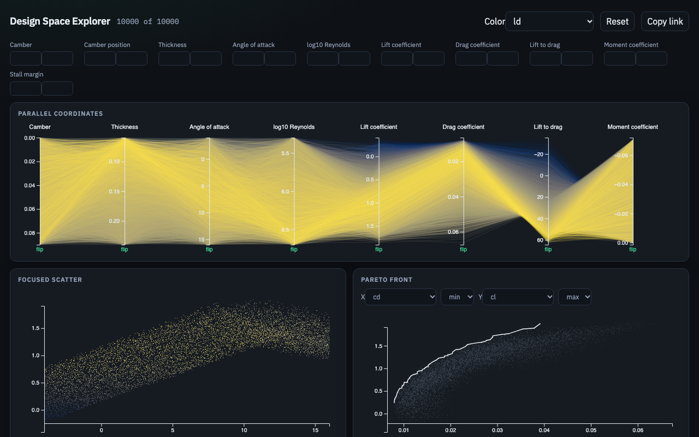
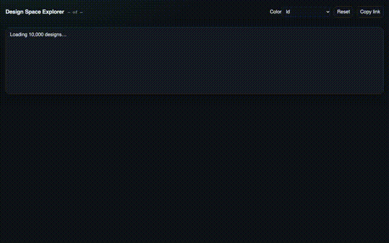
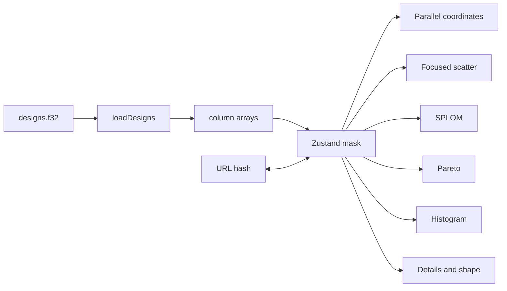

# Design Space Explorer

[](https://github.com/jaworskig00/design-space-explorer/actions/workflows/ci.yml)

Linked views over 10,000 synthetic NACA 4-digit airfoils. Brush one axis and the scatter, parallel coordinates, matrix, Pareto front, and histogram all show the same subset. A pinned design draws its outline and lists every column. The selection and the brushes live in the URL hash.





## What the numbers are

The outline is the real NACA 4-digit closed-trailing-edge geometry. Lift, drag, and pitching moment are **not** from XFOIL, a panel code, or CFD. They come from the documented surrogate in [`data/MODEL.md`](data/MODEL.md) (ADR-002 in [`docs/DECISIONS.md`](docs/DECISIONS.md)). A row is feasible when stall margin is at least 0 and thickness is between 8% and 20% of chord. The nearest NACA label is the nearest 4-digit code, not an exact match.

## Run

Node 22 or newer and pnpm 10.

```bash
pnpm install
pnpm dev
```

Open the URL Vite prints. `pnpm build` writes a static `dist/` and fails if the JavaScript gzip size exceeds 500 KB. `pnpm preview` serves that build.

## Data

The committed table is `public/data/designs.f32` (column-major float32, 10,000 rows, seed 42) plus `public/data/schema.json`. Regenerate it from `data/` with [uv](https://docs.astral.sh/uv/) and Python 3.12:

```bash
cd data
uv sync
uv run python generate.py
uv run python -m unittest discover -s tests -v
```

The generator does not call a flow solver. See [`data/SCHEMA.md`](data/SCHEMA.md) for column order, units, and the feasible predicate.

## Views

| View               | Still                                       |
| ------------------ | ------------------------------------------- |
| Focused scatter    | [scatter.png](docs/screenshots/scatter.png) |
| Brushed subset     | [brushed.png](docs/screenshots/brushed.png) |
| Scatterplot matrix | [splom.png](docs/screenshots/splom.png)     |
| Pareto front       | [pareto.png](docs/screenshots/pareto.png)   |
| Pinned design      | [details.png](docs/screenshots/details.png) |

Default scatter is angle of attack against lift coefficient, colored by lift-to-drag with cividis. The Pareto plot minimizes drag and maximizes lift among feasible rows only. Infeasible points stay on the plot as ghosts and never sit on the front.

**How to use** opens the same notes on demand, and again on the first visit. Keyboard, when focus is not in a field: `→` / `←` walk the filtered designs, `Escape` clears the pin, `r` clears brushes, `[` / `]` change the color column.

## Architecture



Marks are canvas. Axes, brushes, the Pareto polyline, and the airfoil outline are SVG. D3 is imported as modules (`d3-scale`, `d3-brush`, `d3-zoom`, and so on), not as one `d3` bundle.

Hover uses a quadtree while more than 4,000 rows match. At or below that count the scatter switches to a Delaunay nearest-neighbour query. The filter mask stays on the main thread. It is a single AND of inclusive ranges.

## Performance

Measured in Playwright against `pnpm preview`, not the dev server. `e2e/perf.spec.ts` fails if a budget is missed.

| Budget                              | Limit  |
| ----------------------------------- | ------ |
| First paint after the data response | 1.5 s  |
| Parallel-coordinate redraw          | 16 ms  |
| Scatter redraw                      | 16 ms  |
| SPLOM redraw                        | 50 ms  |
| Hover hit-test                      | 2 ms   |
| Filter mask, 10k rows               | 2 ms   |
| JavaScript gzip                     | 500 KB |

Re-measure with:

```bash
pnpm build
pnpm e2e
```

The current script is about 114 KB gzipped. No worker is used. ADR-006 in `docs/DECISIONS.md` is the source of the numbers.

## Tests

```bash
pnpm lint
pnpm typecheck
pnpm test
pnpm build
pnpm e2e
```

GitHub Actions runs the same web checks on Node 22 and the Python unittest job. The task list is [`docs/PLAN.md`](docs/PLAN.md).

## Deploy

The live site is [GitHub Pages](https://jaworskig00.github.io/design-space-explorer/). `main` builds `dist/` with the project base path and the Pages workflow publishes it. Local `pnpm dev` and CI keep the base at `/`.

## License

[MIT](LICENSE) © 2026 Grzegorz Jaworski.
