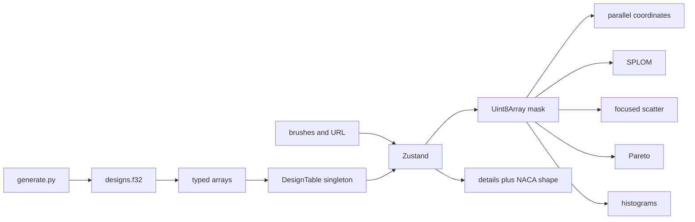

# Design Space Explorer — plan

Static, public, portfolio-grade explorer for about 10,000 synthetic airfoil designs. Views are linked. D3 is idiomatic and visible. Coefficients are a documented surrogate, not a solver. No ML in v1.

Source of truth for product decisions: `docs/DECISIONS.md`. This file is the task order.

## Before you start autonomous mode

Run this checklist and append the results to `docs/PROGRESS.md` before ticking M0.1. Do not change `git config`. Do not run an interactive `gh auth login`. If auth or push permission fails, log it in `docs/QUESTIONS.md` and stop the GitHub steps only.

- `gh auth status` shows `jaworskig00` with `repo` scope
- `git config user.name` and `git config user.email` are set
- `node -v` is 22.x, or a newer local Node that can still install the Node 22 toolchain. CI uses 22 from `.nvmrc`
- `pnpm -v` is 10.x
- `python3 --version` is 3.12.x and `uv --version` runs
- After M0.4: `pnpm exec playwright install chromium` has been run once
- `git push` to `jaworskig00/design-space-explorer` is allowed

Checked on 2026-10-24 while writing this plan: `gh` was logged in as `jaworskig00` (`repo`, `workflow` scopes), git identity was set, local Node was v25 (CI still pins 22), pnpm 10.30, Python 3.12.12, uv 0.9.16. Re-check at the start of M0. Do not trust this paragraph as a substitute.

## Goals

- A hiring manager sees a linked engineering dashboard within 30 seconds: brushing one view filters the others, and a selected design shows its numbers and a NACA outline.
- Interactions stay inside the budgets in ADR-006 at 10k rows.
- The code shows scales, axes, brushes, zoom, transitions, quadtrees, and Delaunay without a wrapper that hides D3.
- A reader can regenerate the dataset and see why it is not CFD.

## Non-goals

- XFOIL, panel methods, CFD, or any claim that the coefficients are simulated
- ML, embeddings, or an LLM filter
- Deploy (M10 is a placeholder)
- The Neural Wind Tunnel app itself
- Disjunctive brushes, lasso selection, 3-objective Pareto
- Tailwind, Next.js, a component library, the monolithic `d3` package

## Success criteria for the demo

- `pnpm install && pnpm dev` serves the dashboard
- The count reads 10,000
- A brush on angle of attack changes the filter count, the scatter, the SPLOM, the Pareto ghosts, and the histograms together
- Clicking a point pins it; the details panel and the outline match that row
- Reloading the URL restores the brushes and the pin
- `pnpm test`, `pnpm e2e`, and CI are green
- The README states that the coefficients are synthetic

## Architecture

Data flow:

1. `data/generate.py` writes `public/data/designs.f32` and `public/data/schema.json`.
2. The client fetches both, builds column `Float32Array`s, and keeps them outside React.
3. Brush actions write 1D ranges and recompute the mask.
4. Canvas layers read the table and the mask. React renders the shell, the toolbar, the number inputs, and the details panel.

Layout, top to bottom:

- Toolbar: title, filter count, color select, reset, copy-link
- Parallel coordinates, full width, about 280px tall
- Focused scatter and Pareto, two columns
- SPLOM, and a side column with the histogram plus the details panel and the shape

## Stack

One line each. Rationale is in the ADRs.

- Vite + React + TypeScript strict — static SPA, D3 owns the chart DOM
- pnpm, Node 22 on CI — lockfile and reproducible CI
- Zustand — brush state without rerendering on hover
- D3 submodules — scales, axes, brush, zoom, shape, quadtree, delaunay, chromatic
- lz-string — shareable hash without a backend
- Vitest — pure functions and the mask budget
- Playwright — linked-view smoke, screenshots, paint budgets
- uv + NumPy — deterministic generator, no SciPy
- husky + lint-staged + ESLint + Prettier — fast pre-commit, full check on CI

## Risks

- A 10×10 SPLOM will miss the 50 ms budget. Default is five columns and the upper triangle (ADR-003). A worker is only the M8 escape hatch.
- The surrogate can emit silly coefficients. The band test gates the binary (ADR-002). Fix the coefficient, do not clip in secret.
- Canvas and React Strict Mode double-mount. Every chart effect must cancel animation frames and `brush.on('.')` / `zoom.on('.')` on cleanup.
- Putting the table or the hover id into React state will drop frames. ADR-004 forbids it.
- Drag-to-pan and drag-to-brush cannot share the same gesture. ADR-011 is the rule.

## Definition of done for v1

M0 through M9 are checked. CI on `main` is green. Tag `v1.0.0` exists. The README has a recording, screenshots, the architecture diagram, the honesty note, and the local commands. `docs/QUESTIONS.md` lists anything still open. M10 is not required.

## v2 backlog

Do not start these during v1.

- OR-brushes on a single axis
- 3-objective Pareto
- In-browser model that marks unexplored or promising regions
- Optional bring-your-own-key natural-language filters that only write the same brush state
- A shared data package consumed by the wind tunnel
- Deploy to Cloudflare, GitHub Pages, or Hetzner

## Task loop

After every task below: verify, run the checks named in `AGENTS.md`, commit, push, tick the box, append `docs/PROGRESS.md`. If CI fails, fix it before the next task. Commit subjects stay specific. Do not batch several tasks into one commit.

Suggested tags, once the last task of a milestone is green: `v0.1.0-m0`, `v0.2.0-m1`, `v0.3.0-m2`, `v0.4.0-m3`, `v0.5.0-m4`, `v0.6.0-m5`, `v0.7.0-m6`, `v0.8.0-m7`, `v0.9.0-m8`, `v1.0.0` after M9. Update `CHANGELOG.md` in the tag commit.

---

## M0 — Scaffold and CI

### M0.1 Tooling skeleton

- [ ] Create the Vite React-TypeScript app in this repo without discarding the planning docs. Add `.nvmrc` (already `22`), `packageManager` in `package.json`, strict `tsconfig`, ESLint, Prettier, and scripts `dev`, `lint`, `typecheck`, `test`, `build`, `preview`.
- Acceptance: `pnpm install && pnpm dev` serves a page titled "Design Space Explorer". `pnpm lint`, `pnpm typecheck`, and `pnpm test` exit 0. The test can be a single passing placeholder.
- Verify: those four commands.

### M0.2 App shell

- [ ] Replace the Vite starter with the dashboard regions (toolbar, five view slots, details slot) and the color tokens from ADR-001. Load IBM Plex from `fontsource`. No chart logic yet.
- Acceptance: regions are visible and labeled, including empty states. Keyboard focus rings exist on the toolbar controls.
- Verify: `pnpm dev` and a quick look; unit test is unchanged and still green.

### M0.3 Unit runner and bundle budget

- [ ] Vitest is the test runner. `scripts/check-bundle-size.mjs` gzips every `dist/assets/*.js` and exits non-zero above 500 KB. `pnpm build` runs the check after `vite build`, or a `pnpm size` script does and CI calls it.
- Acceptance: a deliberately huge string is not required; the empty build passes. The script fails in a unit-level way if pointed at a buffer larger than the budget (test the function, not the real bundle).
- Verify: `pnpm test && pnpm build`.

### M0.4 Playwright smoke

- [ ] `playwright.config.ts` builds nothing by itself. `webServer` runs `pnpm preview --strictPort --port 4173`. CI builds first. One test opens `/` and expects the title and the five region labels. Install Chromium locally once.
- Acceptance: `pnpm build && pnpm e2e` passes.
- Verify: that command.

### M0.5 Git hooks

- [ ] husky pre-commit runs lint-staged (Prettier, then ESLint) on staged JS/TS/CSS/MD. It does not run Vitest or Playwright.
- Acceptance: a staged formatting error is rewritten or rejected by the hook. Document the hook in `AGENTS.md` only if the command differs from what is already written.
- Verify: `git commit` on a tiny formatted change succeeds. Amend only if the hook rewrites files and the usual amend rules allow it; otherwise a second commit is fine. Prefer one commit for M0.5 that is already formatted, and prove the hook with `pnpm exec lint-staged`.

### M0.6 CI

- [ ] `.github/workflows/ci.yml` on push and pull_request: checkout, pnpm, Node 22, frozen lockfile, lint, typecheck, test, build, size check, Playwright with a cached Chromium. Add the status badge to `README.md`.
- Acceptance: the workflow file is valid and the badge URL targets `ci.yml`. No Python job yet (ADR-008).
- Verify: push, then `gh run watch` or `gh run list` until the run completes green. If it fails, fix before M1.

---

## M1 — Dataset

### M1.1 Model and geometry

- [ ] `data/pyproject.toml` depends on NumPy only and requires Python `>=3.12`. Implement `naca.py` and `model.py` exactly as ADR-002. `data/MODEL.md` leads with the honesty paragraph and the formulas. `data/SCHEMA.md` documents column order, units, the feasible predicate, and that `id` is the row index.
- Acceptance: importing the model does not need the network. Formulas match ADR-002.
- Verify: `cd data && uv sync`.

### M1.2 Generator

- [ ] `data/generate.py` writes `public/data/designs.f32` and `public/data/schema.json` for n = 10,000, seed 42. Column-major float32. Also write `data/fixtures/naca-golden.json` for exact 0012 and 2412 (81 cosine-spaced points, upper and lower surfaces).
- Acceptance: binary length is 400,000 bytes. Schema column order matches ADR-002. Running the script twice is byte-identical.
- Verify: run it twice and `cmp` the outputs.

### M1.3 Python tests

- [ ] `data/tests/` uses `unittest`. Assert the band on every row, determinism of a 128-row sample, closed trailing edge (first and last point meet within `1e-6`), and the golden file's 0012 thickness at `x = 0.3` is stable across a second generate. Commit `data/fixtures/pareto-6.json` from ADR-007 for later; the Python suite does not need to implement Pareto.
- Acceptance: `cd data && uv run python -m unittest discover -s tests -v` passes. If the band fails, adjust coefficients per ADR-002 and record the change. Do not commit a failing binary.
- Verify: that unittest command.

### M1.4 CI data job

- [ ] Add a `data` job to `ci.yml`: setup uv, Python 3.12, `uv sync`, unittest. Do not regenerate or overwrite the binary in CI.
- Acceptance: both jobs are green on the push that adds them.
- Verify: `gh run list` for that commit.

---

## M2 — State, URL, and a real shell

### M2.1 Loader

- [ ] `src/data/loadDesigns.ts` fetches the schema and the binary and returns column `Float32Array`s. `src/data/types.ts` exports the column name union. A Vitest test uses a tiny hand-built binary (4 rows) and checks a known value. The app loader reads `/data/designs.f32`.
- Acceptance: the test passes without Playwright. Column order is asserted against `schema.json`.
- Verify: `pnpm test`.

### M2.2 Filter mask

- [ ] `src/state/filter.ts` is pure: ranges in, `Uint8Array` out, AND across columns, missing range means "all". Inclusive bounds. Vitest covers overlaps, a column left open, and the 10k budget (`< 2 ms` for one pass over the real table, or over a local 10k float32 fixture if the fetch is awkward in Vitest — prefer reading the file from disk).
- Acceptance: budget assertion is in the test output's passing list.
- Verify: `pnpm test`.

### M2.3 Store

- [ ] Zustand store as ADR-004. Actions: `setBrush`, `clearBrushes`, `setHover`, `setSelected`, axis reorder, invert, view column setters. Mask and `matchCount` update inside brush actions. The table is a module singleton set by `initTable`, not a store field.
- Acceptance: a store test sets two brushes and reads `matchCount` without rendering React.
- Verify: `pnpm test`.

### M2.4 URL

- [ ] `src/lib/urlState.ts` roundtrips the ADR-004 object through lz-string. Hash key `s`. Malformed hashes are ignored. `App` writes the hash with a short debounce and `replaceState`, and reads it once on load.
- Acceptance: Vitest roundtrip, including `selected: null` and an empty brush map. A Playwright test can wait until M8; a unit test is enough here.
- Verify: `pnpm test`.

### M2.5 Dashboard wired to the count

- [ ] On load, show the count `10,000` and the live region `10000 of 10000 designs`. Number inputs for each brushable column call `setBrush`. Reset clears them. `data-testid` values: `design-count`, `filter-count`, `brush-<column>-min`, `brush-<column>-max`, `reset-filters`.
- Acceptance: Playwright fills `brush-alpha_deg-min` and `max` with `0` and `4`, and the filter count drops below 10,000 and stays above 0. Reload keeps the hash and the count.
- Verify: `pnpm build && pnpm e2e`.

---

## M3 — Focused scatter

### M3.1 Canvas scatter

- [ ] `src/charts/Scatter.tsx`: canvas marks, SVG axes from `d3-scale` and `d3-axis`, point color from the color column via `cividis`. In-filter points brighter; out-of-filter points faint. ResizeObserver. Cleanup on unmount.
- Acceptance: the region is no longer an empty state. A Playwright screenshot `docs/screenshots/scatter.png` at 1280×800 shows axes and a cloud, not a blank panel.
- Verify: `pnpm build && pnpm e2e`. Inspect the screenshot.

### M3.2 Zoom and brush

- [ ] Wheel zooms, Shift+drag pans, double-click resets, drag brushes in data coordinates (ADR-011). The brush calls `setBrush` for the x and y columns. Axes and points share the zoom transform.
- Acceptance: brushing a corner of the scatter changes `filter-count`. Reset restores `10000 of 10000 designs`. A unit or component test is unnecessary if Playwright covers the count change; also assert the number inputs update to the brushed domain within a small tolerance.
- Verify: `pnpm e2e` with a new spec that brushes and resets.

### M3.3 Hover

- [ ] Quadtree over in-filter points, rebuilt when the mask or the zoom domain changes. When the filtered count is ≤ 4000, build `d3-delaunay` and use it for nearest hover. Hover updates a highlight canvas only. Moving the pointer does not change React state in `App` (subscribe outside render).
- Acceptance: hovering a point does not reset the filter count. `pnpm test` still passes. Hit-test of a known point in a Vitest quadtree fixture returns that index.
- Verify: `pnpm test && pnpm e2e`.

---

## M4 — Parallel coordinates

### M4.1 Lines and axes

- [ ] `src/charts/ParallelCoordinates.tsx`. Canvas polylines for context and for the filter. SVG axis per active column. Default order from ADR-004. Faint context, stronger in-filter lines.
- Acceptance: screenshot `docs/screenshots/overview.png` shows the coordinates above the scatter. With no brush, lines span the axes.
- Verify: screenshot spec, then look at the file.

### M4.2 Axis brush

- [ ] `d3-brush` on each axis, one range, stored via `setBrush`. Brushing angle of attack moves the scatter and the filter count together.
- Acceptance: Playwright brushes the axis (or, if the SVG brush is brittle, uses the number input and asserts the axis brush overlay moves). The scatter screenshot changes versus the unbrushed frame.
- Verify: `pnpm e2e`. Keep `docs/screenshots/brushed.png`.

### M4.3 Reorder and invert

- [ ] Dragging an axis title reorders `axes` in the store and animates x positions over 300ms unless reduced motion is set. An invert control flips that scale's domain and is reflected in the URL.
- Acceptance: after a reorder, the URL hash changes and a reload keeps the new order. Vitest can encode order in the URL helper; Playwright checks one invert by reading the axis endpoint labels.
- Verify: `pnpm test && pnpm e2e`.

---

## M5 — SPLOM

### M5.1 Matrix

- [ ] `src/charts/Splom.tsx`. One canvas. Default columns from ADR-003. Upper triangle is scatter cells; diagonal is 40-bin histograms of that column. Axes only on the outer left and bottom. Out-of-filter points faint.
- Acceptance: screenshot `docs/screenshots/splom.png` shows a triangle, not a full square of ten variables. The column toggle can add `camber` and the matrix grows by one.
- Verify: `pnpm e2e` and the screenshot.

### M5.2 Cell brush

- [ ] An axis-aligned brush on an off-diagonal cell sets the two column ranges. A brush on the diagonal histogram sets that one column. Both go through the same store as the parallel coordinates.
- Acceptance: brushing the `cl`/`cd` cell changes `filter-count` and the parallel-coordinate highlight. Clearing via Reset empties it.
- Verify: `pnpm e2e`.

### M5.3 Budget

- [ ] Playwright times a full SPLOM redraw triggered by `brush-thickness-min/max`. Fail the test above 50 ms. If it fails, drop the default to four columns and record that in `docs/DECISIONS.md` as an amendment to ADR-003. Do not start with a worker.
- Acceptance: the perf spec passes on the production preview.
- Verify: `pnpm build && pnpm e2e`.

---

## M6 — Pareto

### M6.1 Front algorithm

- [ ] `src/lib/pareto.ts` implements ADR-007 for two objectives and a direction each. Infeasible rows are excluded. Vitest uses `data/fixtures/pareto-6.json` and expects the three front ids described in the ADR.
- Acceptance: the fixture test passes, including the infeasible point that would otherwise be non-dominated.
- Verify: `pnpm test`.

### M6.2 View

- [ ] `src/charts/Pareto.tsx` draws ghosts for infeasible rows, dim dominated rows, and an SVG polyline for the front. Controls pick the two columns and the direction. Drag brushes like the scatter (ADR-011). Extract a shared helper from `Scatter.tsx` only for the duplicated zoom/brush math.
- Acceptance: screenshot `docs/screenshots/pareto.png` shows a front that steps up and to the right for the default (cd horizontal, cl vertical) — low cd at the left, high cl at the top. Switching `cl` from maximize to minimize changes which points sit on the line.
- Verify: `pnpm e2e` and the screenshot.

---

## M7 — Distributions, details, shape

### M7.1 Histogram

- [ ] `src/charts/Histogram.tsx` for `hist` (default `thickness`). SVG, 40 bins. Background is all rows; foreground is the mask. Brush sets that column's range.
- Acceptance: with an angle-of-attack brush active, the thickness histogram's foreground is a subset of the background (foreground bar heights ≤ background). Playwright reads bar heights via element attributes or `data-bin-count`.
- Verify: `pnpm e2e`.

### M7.2 Shape

- [ ] `src/data/airfoilShape.ts` ports the NACA equations. Vitest compares 0012 and 2412 to `data/fixtures/naca-golden.json` within `1e-5`. `src/charts/ShapePreview.tsx` draws the closed path for the pinned id, or a prompt when nothing is pinned.
- Acceptance: the golden test passes. `data-testid="shape-preview"` is present once a design is pinned.
- Verify: `pnpm test`.

### M7.3 Details and linking

- [ ] `src/components/DetailsPanel.tsx` lists every column with units for `selectedId`. Clicking a scatter point, a parallel-coordinate line hit, or a Pareto point sets `selectedId`. Hover highlights that row on every canvas without pinning. The nearest-NACA label is marked as nearest (ADR-002).
- Acceptance: Playwright clicks the scatter, expects `data-testid="details"` to contain the id and a camber value, and expects the shape preview. The wind-tunnel link is absent because `VITE_WIND_TUNNEL_URL` is unset.
- Verify: `pnpm e2e`. Keep `docs/screenshots/details.png`.

---

## M8 — Quality

### M8.1 Keyboard and motion

- [ ] ADR-005 keyboard map. `prefers-reduced-motion` skips the axis-reorder transition (Playwright can emulate the media feature and assert the axis x is final on the next frame).
- Acceptance: ArrowRight changes `selectedId` along the filtered order. Escape clears it. `r` restores the full count when focus is not in an input.
- Verify: `pnpm e2e`.

### M8.2 Accessible names

- [ ] Live region text matches `{matchCount} of {n} designs`. Each canvas has `role="img"` and an `aria-label` that includes the view name and the filter count. Toolbar controls have visible labels.
- Acceptance: Playwright checks the live region and one canvas label before and after a brush.
- Verify: `pnpm e2e`.

### M8.3 Paint budgets

- [ ] Specs for ADR-006: first paint < 1.5 s after the data response, parallel-coordinate redraw < 16 ms, scatter redraw < 16 ms, hover hit-test < 2 ms. Use `performance.now` inside `page.evaluate` around a store action exposed for tests as `window.__explorer` in preview builds only, or around the number-input path if that is the same code. Do not leave a debug global in a way that changes production behavior beyond a thin test hook guarded by `import.meta.env.DEV` or a `?e2e=1` flag. Prefer driving the real inputs if the timer still wraps the chart redraw.
- Acceptance: the spec fails when the threshold is exceeded. Thresholds match ADR-006, not a looser local number.
- Verify: `pnpm build && pnpm e2e`.

### M8.4 Worker escape hatch

- [ ] If M8.3 is green, tick this task with a PROGRESS note "not needed" and do not add a worker.
- [ ] If a budget failed, move that view's rasterization to an `OffscreenCanvas` worker, re-measure, and amend ADR-006 with what moved. Do not move the filter mask unless the mask test itself failed.
- Acceptance: M8.3 is green afterward, or the remaining miss is written in `docs/QUESTIONS.md` with the measured number and v1 still ships only if the miss is under 2× the budget. A miss at or above 2× is a blocker for M9, not a silent tick.
- Verify: `pnpm e2e`.

---

## M9 — Release

### M9.1 Screenshots and recording

- [ ] Commit the screenshots named above. Add a Playwright video of a brush propagating across views, saved as `docs/media/brush.webm`. If `ffmpeg` is on PATH, also write `docs/media/brush.gif`. If it is not, record that in `docs/QUESTIONS.md` and use the webm in the README.
- Acceptance: the files exist and the webm is longer than a single frame.
- Verify: the spec that records the video.

### M9.2 README

- [ ] Rewrite `README.md`: what it is, the honesty paragraph, GIF or webm, the screenshots, the mermaid architecture diagram, notes on canvas vs SVG and the quadtree/Delaunay split, performance budgets and how to re-measure, local commands (`pnpm` and `uv`), CI badge, MIT, link to `docs/PLAN.md`.
- Acceptance: a cold reader can run the app and regenerate the data without opening the plan. The word XFOIL appears only to say we do not use it.
- Verify: read the README against this list.

### M9.3 Tag

- [ ] `CHANGELOG.md` summarizes M0–M9. `docs/QUESTIONS.md` is current. Tag `v1.0.0` on the commit that contains the README. Push the tag.
- Acceptance: `git status` is clean, CI on the tagged commit is green, `gh release view v1.0.0` works if a release was created. A git tag is enough if `gh release create` needs extra confirmation; prefer `gh release create v1.0.0 --notes-from-tag` or a short note from the changelog. Do not force-push the tag.
- Verify: `gh run list` and `git ls-remote --tags origin v1.0.0`.

---

## M10 — Deploy placeholder

### M10.1 README note only

- [ ] Add a short "Deploy" section: the app is a static `dist/` and the target is not chosen. Do not create a Cloudflare, GitHub Pages, or Hetzner config. Do not buy a domain.
- Acceptance: the section exists and no workflow deploys the site.
- Verify: `rg -n "pages-deploy|wrangler deploy" .github || true` returns nothing.

This task is optional for the v1 tag. Do it after `v1.0.0` if it was not already in the README, and do not move the tag.
